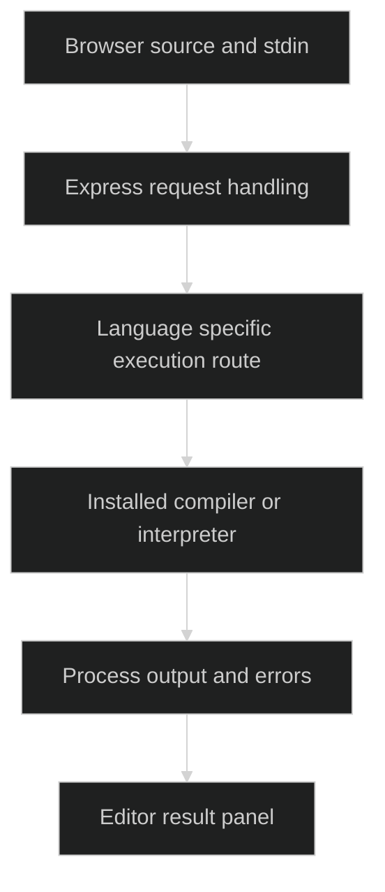

# Online Code Editor

> `A browser editor with Express routes for language-specific execution workflows.`

### 🏗️ System Architecture



### 🛠️ Production Stack

Node.js · Express · browser JavaScript · MySQL · Passport · external language runtimes

### ⚡ Key Engineering Capabilities

- Language-specific pages organize editing and execution requests.
- Express separates application routing and user/session concerns.
- Backend handlers return execution output to browser views.

### 🚀 Deployment and Local Setup

Run from the repository root after cloning:

```bash
git clone https://github.com/ryash14/OnlineCodeEditor.git
cd OnlineCodeEditor
npm install
npm start
```

Configure MySQL, session/authentication settings and required compiler/interpreter paths. `npm start` uses `bin/www`; inspect its port configuration. Host subprocess execution is not a secure sandbox. Keep execution local until isolation, resource limits and access controls exist. Earlier percentage performance claims are omitted because no reproducible benchmark accompanies them.

### Source Map

- [app.js](app.js)
- [server.js](server.js)
- [routes/index.js](routes/index.js)
- [package.json](package.json)
