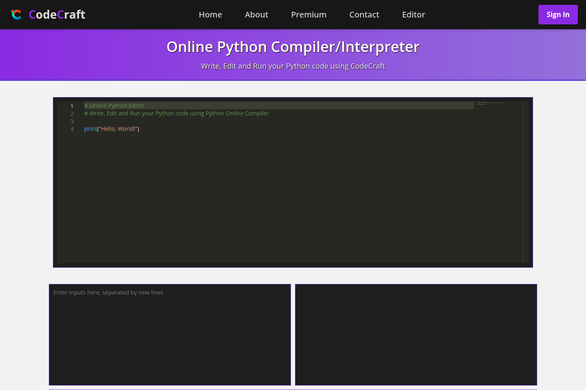
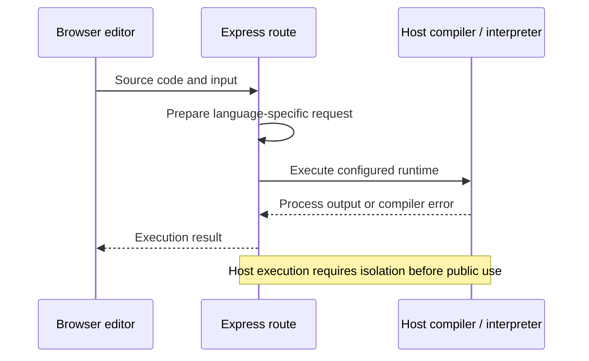

# Online Code Editor

A browser code editor with Express routes for language-specific execution and returned process output.

The application demonstrates how an editor request becomes a compiler or interpreter invocation and how output returns to the browser. It also includes the surrounding user/session pages. The execution path is a local systems experiment, not an isolated multi-tenant code runner.

[Preview](#application-preview) · [Quick start](#quick-start) · [Architecture](#architecture-and-request-flow) · [Development](#development) · [Contributing](CONTRIBUTING.md)

## Application preview



The Python editor with its code and input/output panes. The capture shows the editing interface before execution.

[Screenshot notes](docs/screenshots/README.md)

## Capabilities

| Workflow | Result |
|---|---|
| Choose a language | Use a language-specific browser editing page. |
| Submit a program | Send source and input to the configured execution route. |
| Inspect output | Read compiler or interpreter output returned by the backend. |

## Quick start

Install Node.js, MySQL and only the compiler/interpreter runtimes you intend to use. Configure connection/session settings and executable paths before testing an execution route. Start on a trusted local machine.

From a fresh checkout:

```bash
git clone https://github.com/ryash14/OnlineCodeEditor.git
cd OnlineCodeEditor
npm install
npm start
```

Configure MySQL, session/authentication settings and required compiler/interpreter paths. `npm start` uses `bin/www`; inspect its port configuration. Host subprocess execution is not a secure sandbox. Keep execution local until isolation, resource limits and access controls exist. Earlier percentage performance claims are omitted because no reproducible benchmark accompanies them.

## Architecture and request flow

1. Configure the database, application settings and language runtimes.
2. Open an editor page for the target language.
3. Submit source code and any input to the backend.
4. Inspect stdout, stderr or compiler feedback in the editor view.

### Component model



### Engineering decisions

The npm start script launches `bin/www`, which loads the Express application. Additional execution logic lives in `server.js` and route files; inspect the actual route wiring before assuming that every standalone server handler is exposed by the default entrypoint.

Compiler paths, temporary files and host subprocess behavior are deployment-specific. Public execution requires sandbox isolation, process limits and filesystem boundaries that this repository does not establish.

## Implementation

**Stack:** Node.js · Express · browser JavaScript · MySQL · Passport · external language runtimes.

- [app.js](app.js)
- [server.js](server.js)
- [routes/index.js](routes/index.js)
- [package.json](package.json)

## Development

There is no complete automated verification command documented for this application. Start the affected component, use a small synthetic input and inspect its output before changing integrations. The contribution guide describes the evidence expected in a pull request.

## Contributing and support

Report reproducible bugs or propose changes through [GitHub Issues](https://github.com/ryash14/OnlineCodeEditor/issues). Include the relevant environment and a small example rather than private datasets or credentials. See [contributing](CONTRIBUTING.md), [security reporting](SECURITY.md) and the [code of conduct](CODE_OF_CONDUCT.md).

## License

[MIT](LICENSE). Existing third-party notices remain applicable.
